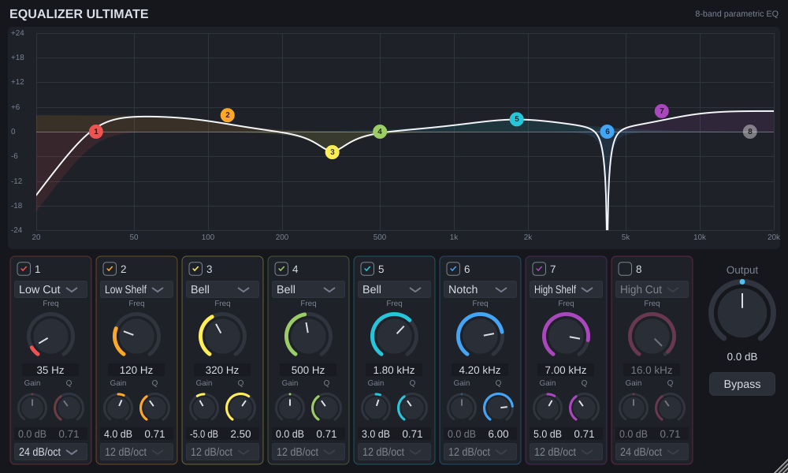

# Equalizer Ultimate

An 8-band parametric EQ audio plugin (VST3) built with [JUCE](https://github.com/juce-framework/JUCE) 9.



## Features

- **8 fully parametric bands**, each switchable between Low Cut, Low Shelf, Bell, Notch, High Shelf and High Cut
- **Cut slopes** of 12, 24, 36 or 48 dB/oct (Butterworth cascades; the 12 dB/oct slope has an adjustable Q)
- Frequency 20 Hz – 20 kHz, gain ±24 dB, Q 0.1 – 18
- **Interactive response curve**: drag a band's node to set frequency/gain, scroll over it to change Q,
  double-click to switch it on/off. Each band's contribution is shaded in its colour.
- Smoothed parameter changes (no zipper noise when automating), output gain, and a host-aware bypass
- Mono and stereo, state save/restore, fully automatable
- Transparent by default: all bands sit at 0 dB and the outer cut bands start disabled

## Download

Every push builds the plugin for Windows, macOS (universal) and Linux on GitHub Actions.
Open the **Actions** tab, pick the latest run and download the `EqualizerUltimate-VST3-<OS>` artifact.
Copy `Equalizer Ultimate.vst3` into your VST3 folder:

| OS      | Folder                                     |
|---------|--------------------------------------------|
| Windows | `C:\Program Files\Common Files\VST3`       |
| macOS   | `~/Library/Audio/Plug-Ins/VST3`            |
| Linux   | `~/.vst3`                                  |

> macOS builds from CI are not code-signed. If your DAW refuses to load the plugin, run
> `xattr -dr com.apple.quarantine "~/Library/Audio/Plug-Ins/VST3/Equalizer Ultimate.vst3"`.

## Building

Requirements: CMake 3.22+, a C++17 compiler (Visual Studio 2022, Xcode 15+, or GCC/Clang), and Git.
JUCE 9.0.6 is downloaded automatically during configure.

```sh
cmake -B build -DCMAKE_BUILD_TYPE=Release
cmake --build build --config Release
```

The plugin ends up in `build/EqualizerUltimate_artefacts/Release/VST3/`.

On Linux, install JUCE's dependencies first:

```sh
sudo apt install libasound2-dev libjack-jackd2-dev libcurl4-openssl-dev libfreetype-dev libfontconfig1-dev \
  libx11-dev libxcomposite-dev libxcursor-dev libxext-dev libxinerama-dev libxrandr-dev libxrender-dev \
  libxi-dev libgl-dev libegl-dev
```

Options:

- `-DEQU_JUCE_PATH=/path/to/JUCE` — use a local JUCE checkout instead of downloading it
- `-DEQU_BUILD_TESTS=OFF` — skip the test program

## Tests

`EqualizerUltimateTests` runs the real processor offline with sine waves and checks the results: default
transparency, bell/shelf/notch gain, cut slopes and corner frequency, output gain, bypass, that the UI's
drawn curve matches the processed audio, random automation stability, bus layouts, state round-trip, and
that the editor builds and paints.

```sh
ctest --test-dir build -C Release --output-on-failure
```

Set `EQU_SCREENSHOT=/some/path.png` when running the test binary to save a render of the editor.

## Project layout

```
Source/EQBand.*           Biquad coefficient design and magnitude response (allocation-free)
Source/PluginProcessor.*  Parameters, smoothing, per-band filter cascades, state
Source/ResponseCurve.*    Interactive frequency-response display
Source/PluginEditor.*     Band strips, output section, look-and-feel
Tests/Main.cpp            Headless tests
```

## Licence

JUCE is dual-licensed under the AGPLv3 and a commercial licence. If you distribute this plugin you must
either release it under the AGPLv3 or hold a suitable JUCE licence. See the
[JUCE licensing page](https://juce.com/get-juce/) for details.
